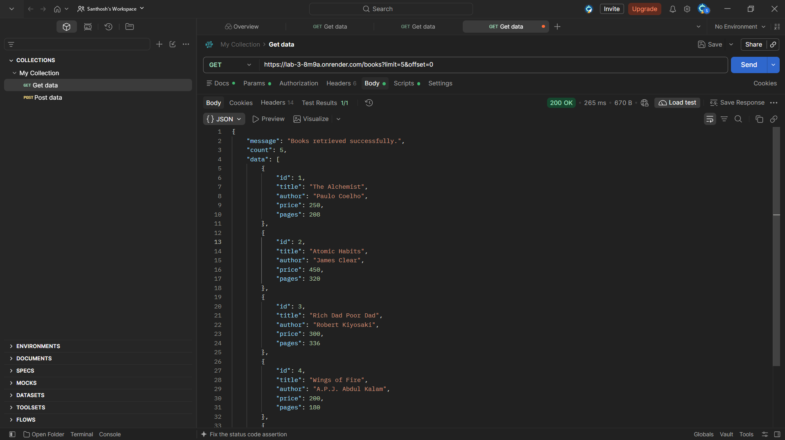

# Lab 3 – REST API, Query Parameters, Validation and Debugging

## Student & Academic Profile

- **Student Name:** K. Sai Santhosh
- **Registration / Roll Number:** 252U1R5072
- **Section:** CSE AIDE-2A-106
- **Course:** Backend Development Fundamentals
- **Lab:** Lab 3 – REST API, Query Parameters, Validation and Debugging
- **Institution:** Aurora Deemed to be University
- **Repository:** https://github.com/santhoshkilaparthi45-svg/SANTHOSH_LAB3
- **Live Deployment URL:** https://santhosh-lab3-api.onrender.com

---

## Deployment URL

**Render Base URL:** https://santhosh-lab3-api.onrender.com
**Books Endpoint:** https://santhosh-lab3-api.onrender.com/books
**Student Verification Endpoint:** https://santhosh-lab3-api.onrender.com/about

---

## Project Description

This project implements a complete, production-ready RESTful Book Management API built with **Node.js**, **Express.js**, and an embedded **SQLite** database (`books.db`). It demonstrates advanced query parameter processing (search filtering across title/author, ascending and descending sorting, limit/offset pagination, and numeric price range filtering), robust input validation rules, and structured error responses.

---

## API Endpoints Reference

| Method | Endpoint | Description | Query Parameters |
| :--- | :--- | :--- | :--- |
| **GET** | `/` | API Directory & Welcome message | None |
| **GET** | `/about` | Student metadata & verification | None |
| **GET** | `/books` | Retrieve books catalog | `search`, `sort`, `page`, `limit`, `minPrice`, `maxPrice` |
| **GET** | `/books/:id` | Retrieve single book by ID | None |
| **POST** | `/books` | Create a new book record | Request body: `{ title, author, price, pages }` |
| **PUT** | `/books/:id` | Update an existing book record | Request body: `{ title, author, price, pages }` |
| **DELETE**| `/books/:id` | Delete book record by ID | None |

---

## Visual Verification & Postman Evidence

All endpoints have been thoroughly tested and validated in Postman desktop:

| Sl. No. | Test Scenario | Postman Capture |
| :---: | :--- | :--- |
| **01** | GET All Books |  |
| **02** | GET Book by ID |  |
| **03** | Search Books by Keyword (`?search=python`) |  |
| **04** | Sort Books Ascending (`?sort=asc`) |  |
| **05** | Sort Books Descending (`?sort=desc`) |  |
| **06** | Pagination (`?page=1&limit=2`) |  |
| **07** | Price Range Filtering (`?minPrice=200&maxPrice=500`) |  |
| **08** | Combined Query Filter (`?search=...&sort=...&page=...`) |  |
| **09** | POST Create Book (201 Created) |  |
| **10** | POST Input Validation Error (400 Bad Request) |  |
| **11** | PUT Update Book (200 OK) |  |
| **12** | DELETE Book Resource (200 OK) |  |

---

## How to Run Locally

```bash
# 1. Clone repository
git clone https://github.com/santhoshkilaparthi45-svg/SANTHOSH_LAB3.git

# 2. Enter project folder
cd SANTHOSH_LAB3

# 3. Install dependencies
npm install

# 4. Start production server
npm start
```
